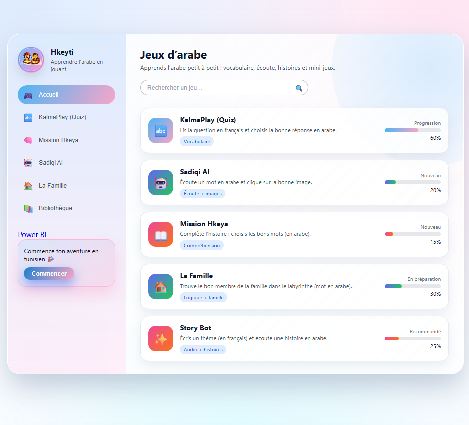
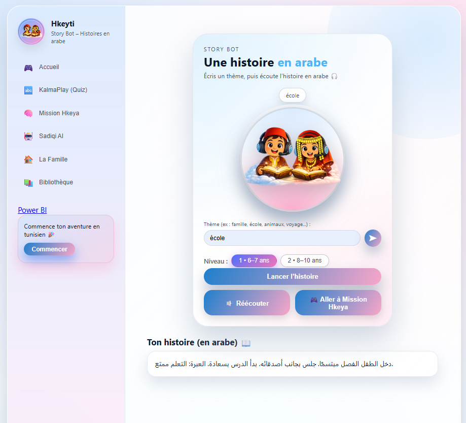
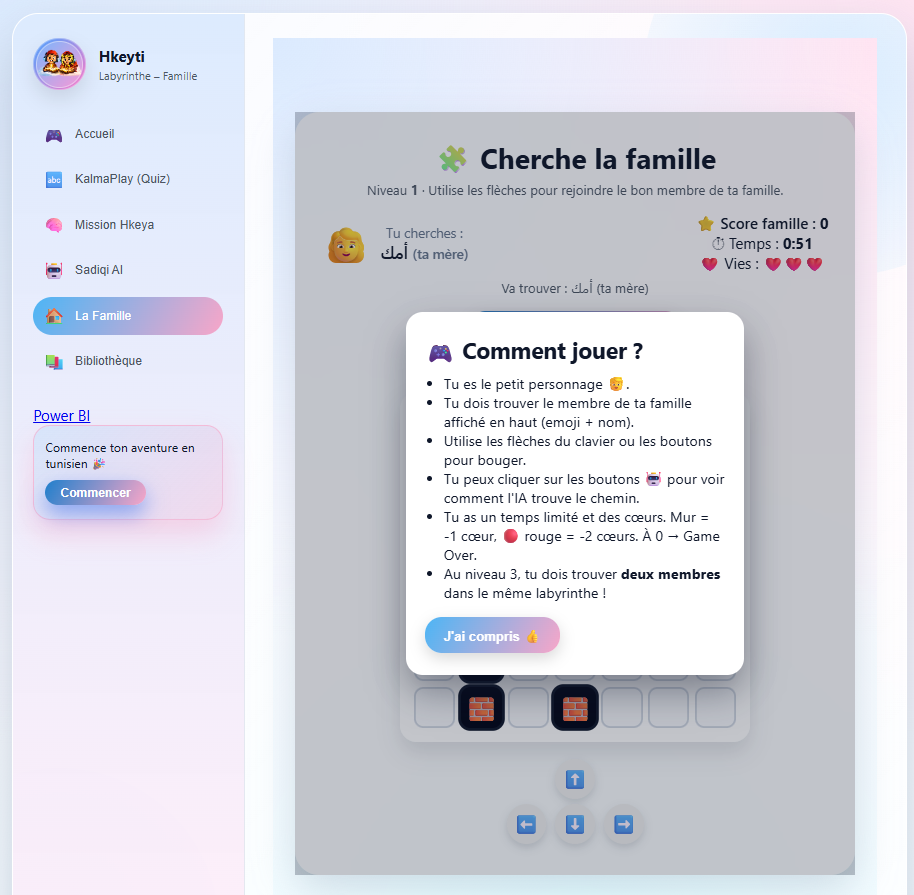
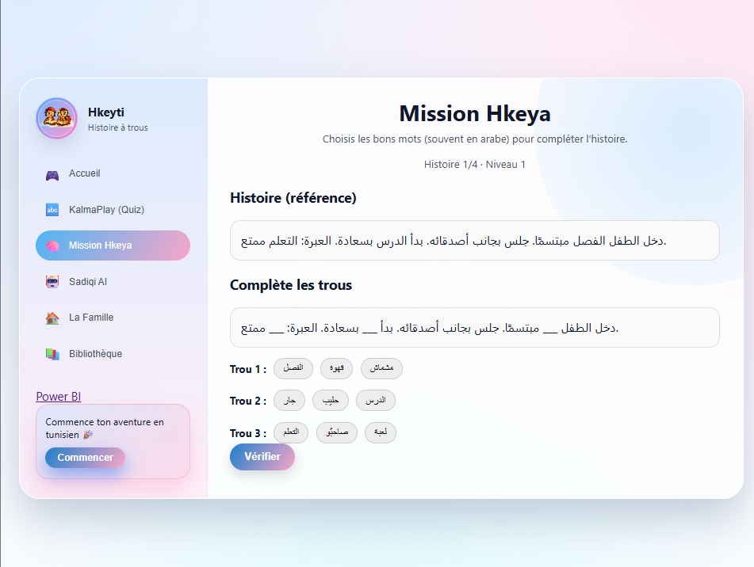

# miniHKEYA – Plateforme éducative en arabe pour enfants, propulsée par l'IA

miniHKEYA est une application web éducative qui aide les enfants à apprendre l'arabe en s'amusant. Elle combine des **histoires générées par un LLM** selon le thème choisi par l'enfant et **trois jeux éducatifs à niveaux**.

Le projet repose sur une architecture **React / FastAPI / PostgreSQL**, avec un **LLM exécuté en local via Ollama**, entièrement **conteneurisée avec Docker** et **déployée sur Microsoft Azure**.



---

## Fonctionnalités

### Histoires générées par IA
- L'enfant choisit un sujet et un thème, et le LLM (Qwen 2.5) génère une histoire courte en arabe adaptée à son âge.
- Lecture de l'histoire par synthèse vocale.
- Historique des histoires enregistré en base de données.

### Jeu 1 – Écoute et choisis
- Un mot est prononcé en arabe (par exemple « دار », la maison).
- L'enfant clique sur l'image qui correspond parmi plusieurs images tirées au hasard.
- Plusieurs niveaux de difficulté, avec des sons de réussite et d'échec.

### Jeu 2 – Le labyrinthe de la famille
- L'enfant déplace un personnage avec les flèches du clavier ou les boutons pour retrouver un membre de sa famille (emoji et nom en arabe).
- Temps limité et système de vies : un mur fait perdre 1 cœur, une case rouge en fait perdre 2.
- Les boutons 🤖 montrent comment l'IA trouve le chemin le plus court grâce à l'algorithme **BFS** (parcours en largeur).
- Au niveau 3, deux membres de la famille sont à trouver dans le même labyrinthe.

### Jeu 3 – Complète l'histoire
- L'enfant choisit les bons mots en arabe pour compléter une histoire.
- Plusieurs niveaux de difficulté.

### Comptes utilisateurs
- Inscription et connexion sécurisées par jeton JWT.

### Tableau de bord d'analyse (Power BI)
- Analyse des journaux d'activité enregistrés dans PostgreSQL (parties jouées et histoires générées).
- Évolution mensuelle de l'activité, répartition jeux / histoires, jeux et thèmes les plus utilisés.
- Filtres interactifs par jeu, type d'activité, utilisateur et période.


---

## Captures d'écran

| Génération d'histoire |
| --- | --- |
|  | 

| Labyrinthe de la famille | Complète l'histoire |
| --- | --- |
|  |  |

---


| Composant | Rôle |
| --- | --- |
| Frontend | Interface, navigation et logique des jeux |
| Backend | API, authentification, appels au LLM, accès aux données |
| PostgreSQL | Utilisateurs, histoires et historique des jeux |
| Ollama | Exécution locale du modèle de langage |

---

## Technologies

| Domaine | Outils |
| --- | --- |
| Frontend | React, Vite, JavaScript, CSS, Nginx |
| Backend | Python 3.11, FastAPI, SQLAlchemy, Pydantic, JWT, Uvicorn |
| Base de données | PostgreSQL 16 |
| IA | Ollama, Qwen 2.5 (1.5B instruct), synthèse vocale |
| Algorithmique | BFS (recherche du plus court chemin) |
| Analyse de données | Power BI |
| DevOps | Docker, Docker Compose, Azure Container Registry, Azure Container Apps |

---

## Lancer le projet en local

### Prérequis
- [Docker Desktop](https://www.docker.com/products/docker-desktop/)
- Environ 3 Go d'espace libre pour le modèle et les images

### Installation

```bash
git clone https://github.com/VOTRE-NOM/minihkeya.git
cd minihkeya
cp .env.example .env
docker compose up --build
```

Au premier lancement, Ollama télécharge automatiquement le modèle `qwen2.5:1.5b-instruct`, ce qui peut prendre quelques minutes.

### Accès

| Service | Adresse |
| --- | --- |
| Application | http://localhost:5173 |
| API | http://localhost:8000 |
| Documentation de l'API (Swagger) | http://localhost:8000/docs |

---

## API

Principaux points d'entrée :

| Méthode | Route | Description |
| --- | --- | --- |
| POST | `/api/auth/register` | Création d'un compte |
| POST | `/api/auth/login` | Connexion, renvoie un jeton JWT |
| GET | `/health` | Vérification de l'état du service |

La liste complète est disponible sur `/docs`.

---

## Déploiement sur Azure

Les images Docker sont publiées sur **Azure Container Registry** puis déployées sur **Azure Container Apps**, avec HTTPS automatique.

- Application : https://ca-minihkeya-frontend.jollyground-f04d0bd3.francecentral.azurecontainerapps.io
- Documentation de l'API : https://ca-minihkeya-backend.jollyground-f04d0bd3.francecentral.azurecontainerapps.io/docs

---

## Structure du projet

```
minihkeya/
├── backend/            # API FastAPI, modèles SQLAlchemy, appels au LLM
├── frontend-react/     # Application React (pages, jeux, images, sons)
├── docs/               # Documentation, captures d'écran et rapport Power BI (.pbix)
├── docker-compose.yml  # Orchestration des services
└── .env.example        # Modèle de configuration
```

---

## Pistes d'amélioration

- Choix de l'âge de l'enfant pour adapter la difficulté des histoires
- Suivi de la progression de l'enfant dans un tableau de bord parent
- Ajout de nouveaux jeux et de nouveaux thèmes

---

## Auteure

**Ines Elouaer** – Ingénieure IA / Machine Learning
[LinkedIn](https://linkedin.com/in/ines-elouaer)
